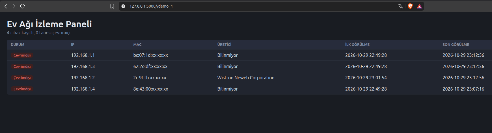

# Home Network Monitor

A lightweight tool that scans your local network, remembers every device it sees, alerts you when an unknown device joins, and shows everything in a live web dashboard.

Built with Python, Scapy, SQLite, Flask and vanilla JavaScript.



## Why this project

Most people have no idea what is connected to their home Wi-Fi. This tool answers three simple questions:

- Which devices are on my network right now?
- When did each device first and last appear?
- Did something new just connect?

## Features

- **ARP network scan** - discovers devices on a subnet using Scapy. Several scan passes are merged so sleeping devices are less likely to be missed.
- **Vendor lookup** - identifies the manufacturer from the MAC address (TP-Link, Samsung, etc.).
- **Persistent device inventory** - every device is stored in SQLite with its first-seen and last-seen timestamps. The MAC address is the primary key, because IP addresses change.
- **New-device alerts** - prints a terminal alert and sends a desktop notification when an unknown MAC appears. The first run is silent so your existing devices are not reported as intruders.
- **Continuous monitoring** - rescans on a fixed interval (default: 60 seconds).
- **Web dashboard** - live table with online/offline status, auto-refreshing every 10 seconds.

## How it works

```
 scanner.py ──► main.py ──► db.py ──► devices.db
 (ARP scan)    (loop +       (SQLite)       ▲
                alerts)                     │
                  │                         │
               alert.py                  app.py ──► templates/index.html
            (notify-send)             (Flask API)     (dashboard UI)
```

1. `scanner.py` broadcasts ARP requests and collects the IP/MAC replies.
2. `main.py` runs the scan in a loop and passes each device to `db.py`.
3. `db.py` inserts unseen MACs, updates known ones, and reports whether a device is new.
4. New devices trigger `alert.py`.
5. `app.py` reads the same database and serves it as JSON to the dashboard.

A device is shown as **online** if it was seen within the last 3 minutes.

## Project structure

```
network-monitor/
├── scanner.py          # ARP scan + MAC vendor lookup
├── db.py               # SQLite storage and new-device detection
├── alert.py            # Terminal and desktop notifications
├── main.py             # Continuous scan loop
├── app.py              # Flask web server and JSON API
├── templates/
│   └── index.html      # Dashboard page
├── requirements.txt
└── README.md
```

## Requirements

- Linux
- Python 3.8+
- Root privileges (Scapy needs them to send raw ARP packets)
- `notify-send` for desktop notifications (optional)

## Installation

```bash
git clone https://github.com/fas0ftware/network-monitor.git
cd network-monitor

python3 -m venv venv
source venv/bin/activate
pip install -r requirements.txt
```

For desktop notifications, install `libnotify`:

```bash
# Debian / Ubuntu / Mint
sudo apt install libnotify-bin

# Fedora
sudo dnf install libnotify

# Arch / Manjaro
sudo pacman -S libnotify
```

## Configuration

Find your subnet with `ip -4 -brief a`. An address like `192.168.1.23/24` means your range is `192.168.1.0/24`.

Open `main.py` and set:

```python
IP_RANGE = "192.168.1.0/24"   # your subnet
ARALIK = 60                   # seconds between scans
```

Do the same for `IP_RANGE` if you use it elsewhere.

## Usage

Run the scanner (needs root, so call the virtual environment's Python explicitly):

```bash
sudo venv/bin/python main.py
```

In a second terminal, start the dashboard (no root needed):

```bash
source venv/bin/activate
python app.py
```

Open [http://127.0.0.1:5000](http://127.0.0.1:5000).

On the first run the database is empty, so the first scan is silent and registers your current devices as known. From then on, any new MAC address triggers an alert.

### Testing the alert

Stop the scanner, delete one device from the database, and start it again:

```bash
sudo venv/bin/python -c "import sqlite3; c=sqlite3.connect('devices.db'); c.execute(\"DELETE FROM devices WHERE ip='192.168.1.X'\"); c.commit()"
sudo venv/bin/python main.py
```

Replace `192.168.1.X` with the device's IP. It will be detected as new.

## Security notes

- **Scan only networks you own or are authorized to test.** Scanning other people's networks may be illegal.
- The dashboard binds to `127.0.0.1`, so it is only reachable from the machine running it, not from other devices on the network.
- SQL queries are parameterized (`?` placeholders), which prevents SQL injection.
- The dashboard writes data into the page with `textContent` instead of `innerHTML`, so a malicious device name cannot inject script into the page.
- `devices.db` and `.env` are listed in `.gitignore`, so your device inventory and future secrets are never committed.

## Known limitations

- **Randomized MAC addresses.** Modern phones use a different private MAC per network, so their vendor shows as "Unknown". The same phone may also appear as a new device if it rotates its address.
- **Sleeping devices.** Some phones and TVs ignore ARP requests in power-saving mode, so they can briefly appear offline.
- **Client isolation.** If your router has AP/client isolation enabled, devices cannot see each other and the scan will find little.
- **Linux only.** The notification code relies on `notify-send` and `/run/user/<uid>/bus`.

## Roadmap

- [ ] Telegram notifications (token stored in `.env`)
- [ ] Name devices and mark them as trusted, alert only on untrusted ones
- [ ] Better handling of randomized MAC addresses
- [ ] Device history and online/offline timeline
- [ ] Port scanning for basic exposure checks
- [ ] Docker setup

## Tech stack

Python · Scapy · SQLite · Flask · JavaScript · HTML/CSS

## License

MIT - see `LICENSE` (add the file if you want to publish under this license).