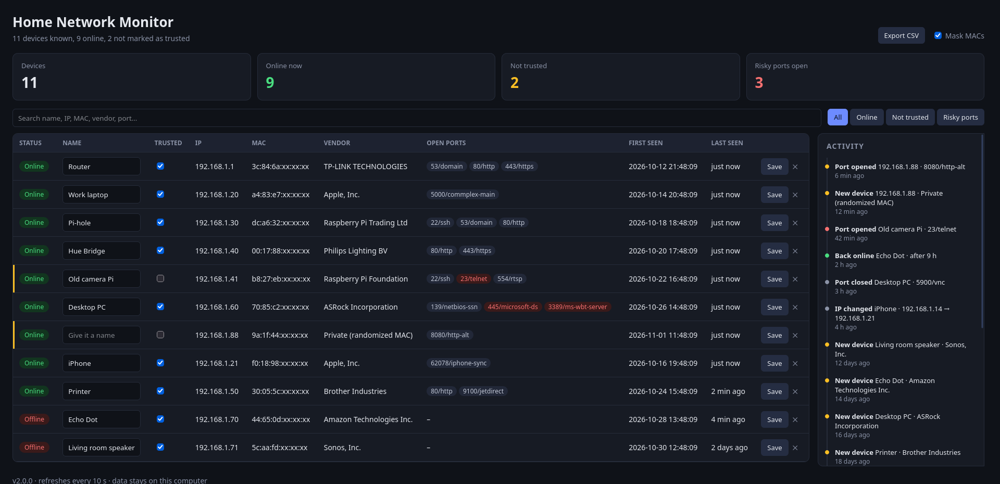
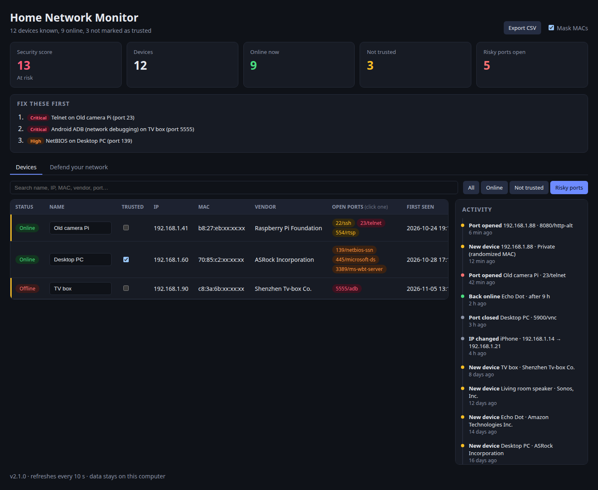
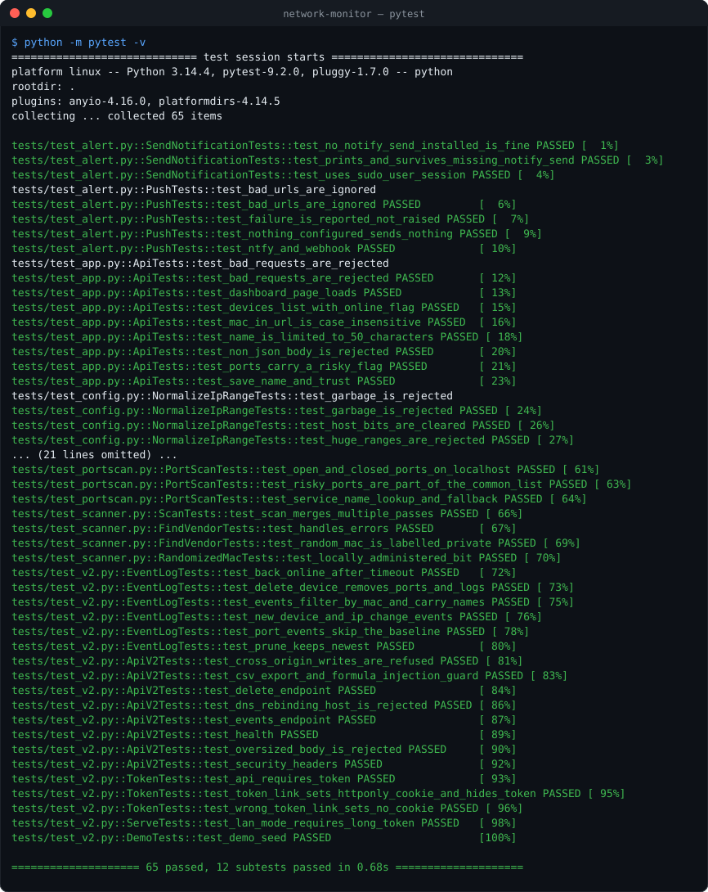
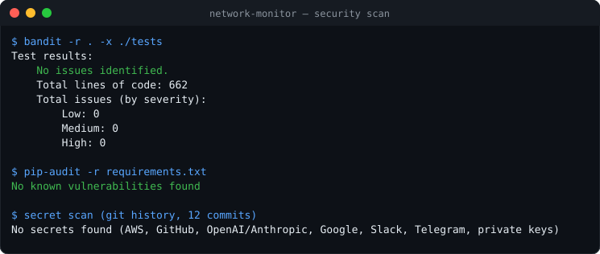

# Home Network Monitor

[](https://github.com/fas0ftware/network-monitor/actions/workflows/ci.yml)


A lightweight tool that scans your home network, remembers every device it sees, checks each one for open ports, **alerts you on your desktop or phone** when something new appears, and shows it all in a live dashboard with an **activity timeline**.

Built with Python, Scapy, SQLite, Flask and vanilla JavaScript – no build step, no cloud, data stays on your machine.



## Why this project

Most people have no idea what is connected to their Wi-Fi. This tool answers:

- Which devices are on my network right now, and which of them do I actually trust?
- Did something new just connect? Did a device change its IP or come back after days?
- Did a device suddenly open a new, possibly risky port (Telnet, SMB, RDP, VNC…)?

## Features

**Discovery & inventory**
- **ARP scan** with Scapy; several passes are merged so sleeping devices are less likely to be missed.
- **Vendor lookup** from the MAC prefix; **randomized private MACs** (phones' per-network addresses) are recognised and labelled.
- **Persistent inventory** in SQLite keyed by MAC, with first/last seen, friendly name and trusted flag.

**Exposure checks**
- **Port scan** of 19 common TCP ports per device (rescanned at most every 30 min), risky services in red.

**Alerts**
- New device, new open port – in the terminal, as a **desktop notification**, and optionally as a **phone push** via [ntfy](https://ntfy.sh) or a **Discord / Slack / Mattermost webhook**.
- The first run is silent (your existing devices become the baseline); port alerts start after a device's baseline scan.

**Dashboard**
- Summary cards (devices, online, not trusted, risky ports), search, quick filters.
- **Activity timeline:** new devices, IP changes, devices back online after a while, ports opened/closed, devices removed.
- Name / trust / **forget** a device, **CSV export**, MAC masking for screenshots (`?mask=1`).

**Security hardening (v2)**
- Listens on `127.0.0.1` by default. Serving on the LAN **requires a token** (16+ characters), exchanged once for an `HttpOnly`, `SameSite=Strict` cookie.
- **DNS-rebinding protection** (trusted `Host` headers) and **CSRF protection** (cross-origin writes refused).
- Strict **Content-Security-Policy** (no inline script), `X-Frame-Options: DENY`, `nosniff`, `no-referrer`, `no-store` on API responses, 16 KB request limit.
- Untrusted text is rendered with `textContent` only; CSV export is protected against spreadsheet formula injection.
- Parameterized SQL everywhere; notification commands are argument lists (no shell) and use `--` so a vendor name can never become an option.

<p align="center"></p>

## How it works

```
 scanner.py ─┐
 (ARP scan)  │
             ├──► main.py ──► db.py ──► devices.db (devices, ports, events)
 portscan.py ┘   (loop +     (SQLite)        ▲
 (TCP ports)      alerts)                    │
                     │                       │
                  alert.py                app.py ──► templates/ + static/
        (desktop, ntfy, webhooks)     (Flask API)      (dashboard)
```

A device counts as **online** if it was seen in the last 3 minutes.

## Installation

Requirements: Linux, Python 3.10+, root for the scanner (raw ARP packets), optionally `notify-send` (`libnotify`).

```bash
git clone https://github.com/fas0ftware/network-monitor.git
cd network-monitor
python3 -m venv venv && source venv/bin/activate
pip install -r requirements.txt
```

## Usage

Try the dashboard without scanning anything:

```bash
python app.py --demo          # throw-away database with sample devices
```

Real use – the scanner in one terminal, the dashboard in another:

```bash
sudo venv/bin/python main.py --range 192.168.1.0/24 --interval 60
python app.py                 # http://127.0.0.1:5000
```

Find your subnet with `ip -4 -brief a` (`192.168.1.23/24` → `192.168.1.0/24`). Ranges larger than `/20` and IPv6 are refused. `main.py --once` scans a single round.

### Configuration (`.env` / environment)

| Variable | Default | Meaning |
|---|---|---|
| `NETMON_IP_RANGE` | `192.168.1.0/24` | Subnet to scan |
| `NETMON_DB` | `devices.db` | SQLite file (read by both programs) |
| `NETMON_NTFY_URL` | – | e.g. `https://ntfy.sh/<long-random-topic>` for phone push |
| `NETMON_WEBHOOK_URL` | – | Discord / Slack / Mattermost incoming webhook |
| `NETMON_HOST` / `NETMON_PORT` | `127.0.0.1` / `5000` | Dashboard address |
| `NETMON_TOKEN` | – | Required (16+ chars) when `NETMON_HOST` is not loopback |

To open the dashboard on your phone: set `NETMON_HOST=0.0.0.0` and a token (`python -c "import secrets; print(secrets.token_urlsafe(24))"`), then visit `http://<pc-ip>:5000/?token=<token>` once.

### API

| Method | Endpoint | Description |
|---|---|---|
| `GET` | `/api/devices` | All devices with status, name, trust flag and open ports (`risky` flag each) |
| `POST` | `/api/devices/<mac>` | `{"name": "Laptop", "trusted": true}` |
| `DELETE` | `/api/devices/<mac>` | Forget a device (it is reported as new if it returns) |
| `GET` | `/api/events?limit=100&mac=…` | Activity log, newest first |
| `GET` | `/api/devices.csv` | Inventory as CSV |
| `GET` | `/api/health` | `{"ok": true, "version": …}` |

## Tests

65 tests (plus subtests) – database and migrations, event log, API, security headers, DNS-rebinding and CSRF guards, token flow, CSV injection guard, port scanner on local sockets, alerts and webhooks (mocked), the scan loop with fake network data, demo data. No root, no network.

```bash
pip install -r requirements-dev.txt
python -m pytest -v
```



## Security scan

CI runs [bandit](https://github.com/PyCQA/bandit) and [pip-audit](https://github.com/pypa/pip-audit) on every push. Latest local scan, including a secret scan of the full git history:



**Scan only networks you own or are authorized to test.** Port scanning other people's networks may be illegal.

## Known limitations

- **Randomized MACs:** a phone may appear as a new device when it rotates its private address (it is labelled as such).
- **Sleeping devices** can briefly show as offline; **client isolation** on the router hides devices from each other.
- Only a fixed list of common **TCP** ports is checked; UDP is not scanned.
- Desktop notifications are Linux-only (`notify-send`); push webhooks work everywhere.

## Changelog

- **2.0.0** – Activity timeline (new device, IP change, back online, port opened/closed, removed), ntfy + Discord/Slack webhooks, forget device, CSV export, summary cards, search and filters, randomized-MAC detection, `--once`, `--demo`; security hardening (token for LAN mode, DNS-rebinding and CSRF guards, CSP and security headers, request size limit, CSV formula guard); English UI; pytest suite; CI security scans.
- **1.0.0** – ARP inventory, port checks, desktop alerts, dashboard with names and trust flags.

## Roadmap

- [ ] Docker image
- [ ] Use the trusted flag to mute port alerts for chosen devices
- [ ] Per-device history chart

---

Python · Scapy · SQLite · Flask · JavaScript · HTML/CSS — Part of the **FA Software** projects. Licensed under the [MIT License](LICENSE).
